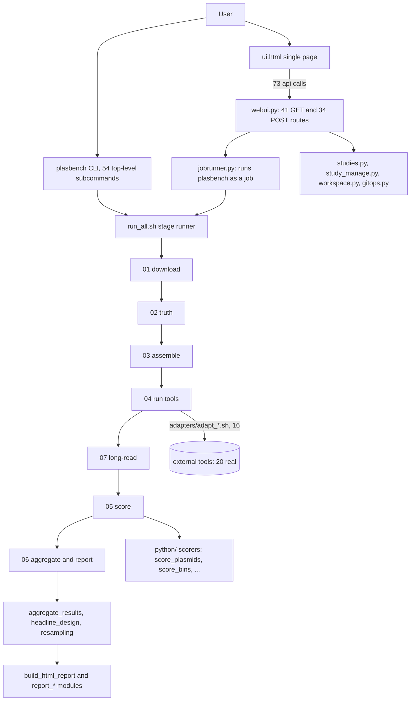
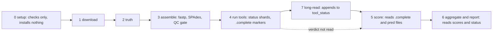

# PlasBench: independent end-to-end audit (17 November 2026)

**Object audited:** `main` at `01c7dd6` (after #117), a fresh checkout. **Nothing was changed, committed or pushed**; all experiments ran in scratch folders and on copies. Companion file: `ISSUE_REGISTER.tsv` (53 issues, the full register with file, function, line, evidence, impact, root cause, recommendation, dependencies and test).

**How it was done.** Seven independent specialists (architecture and backend, scientific metrics, web UI and usability, workflow and resources, report integrity, QA and security, and a challenge of the earlier audits) each worked read-only on the same checkout and ran their own experiments. I then reproduced the most serious new findings myself. Every finding carries one of three labels: **EXECUTED** (code was run and the result seen), **READ** (code or data only), **SUSPECTED** (not confirmed). Findings I reproduced myself are marked **(verified by me)**.

**What this audit could not do** (so the reader knows the boundary): no real plasmid tool except minimap2 was installed, so no adapter was exercised against its real software; no browser was available, so nothing was seen rendered and keyboard, contrast and responsive behaviour are untested; no HPC or multi-node run; Python 3.12 (WSL) and 3.14 (Windows) only; the full benchmark and a real-data run of several tools were not run; NGOC, PlasEval-style dissimilarity, PR-AUC, calibration, composite score and ranking-stability were not independently verified; the web window's cancel path and the Windows suspend path were not run end to end.

---

## 1. Executive audit report (Deliverable 1)

**Can a researcher use PlasBench from beginning to end, with confidence that every operation is correctly executed, every result is defensible, and every reported finding represents what happened?**

**Not yet.** The scoring core is sound and unusually well tested, the interface is connected, and many earlier defects are genuinely fixed. But there are confirmed ways for a run to look successful, or a report to look authoritative, when it is not.

| Area | Condition | Evidence |
|---|---|---|
| Scientific core (base-level and binning scores) | **Good, with named exceptions.** Base TP/FP/FN, P/R/F1/F2/MCC, plasmid recall, length-weighted binning F1, CPRR gates, outcomes, NMI/ARI arithmetic, accuracy (identity, mismatch, indel), Holm and the Wilcoxon test all matched independent reference calculations on hand-built fixtures, including plasmid-free isolates, empty predictions, chimeras and repeats | EXECUTED |
| Scientific supplementary metrics | **Misleading in places.** NMI, Variation of Information and ARI are *perfect* when a whole plasmid is missed (AU-003, verified by me); AMR placement counts a gene on an unbinned contig as correctly placed (AU-004); contig-level F1 drops hard contigs from its denominators (AU-020) | EXECUTED / READ |
| Ground truth | **The weakest scientific link.** Strategy and polish are inferred from NCBI free text; the regexes fail on real tokens (218 rows wrongly `unknown`, AU-005) and nine "independent" isolates are Illumina-polished (AU-006, both verified by me). Only 15% of public-v4 is independent even before that | EXECUTED |
| Workflow reliability | **Not production-grade.** Two runs sharing the default temp directory destroy each other's state while the first reports success (AU-001, Critical); a killed run leaves orphans and can be resumed as a duplicate (AU-009); a hung tool cannot be told from a working one (AU-010); a tool whose output is missing is scored as a genuine zero for 12 of 16 adapters (AU-008) | EXECUTED |
| Report | **Mostly faithful to its data, with a wrong headline layer.** Recomputing 12 quantities from `scores.tsv` agreed with the leaderboard and report; but the report card shows 1000% completion and a grade A (AU-007), "Methods compared" reads 1 for 4 tools (AU-016), a contamination figure is mislabelled (AU-015), and damaged input tables (blank, NaN, status contradicting scores) produce a plausible but wrong ranking or a raw traceback (AU-012) | EXECUTED |
| Interface | **Connected.** All 73 UI API calls reach a handler; no dead buttons; the study lifecycle works. Gaps: five backend routes have no control, 30 silent `catch {}` blocks, inconsistent terminology, no results export | EXECUTED / READ |
| Architecture | **Reasonable for the size** (183 `python/` modules, 21 `plasbench/`, about 58,600 lines, standard library only, no `shell=True`), but with ~13 FASTA readers, ~12 PAF parsers and ~50 table readers that disagree on edge cases (AU-021) | EXECUTED |
| Performance and resources | **Largely unmeasured.** Only stage 4 (runtime, peak RAM) and stage 3 (runtime) are measured; every other stage and every real tool have no measured figure; several estimates are hard-coded | EXECUTED / READ |
| Security | **Authentication holds** (token, Host and Origin checks refused every forged request), but a bundle import can lead to script execution in the served report and then to the terminal route (AU-002); secrets are logged and the commit scanner has gaps | EXECUTED |
| Tests | **Strong where it counts most, thin on guard conditions.** 18 deliberate bugs were planted: 10 killed, 8 survived (CPRR boundary, Holm values, synthetic/real refusal, secret scan, TP clamp). Only 3 of 20 real tools have a real-binary check | EXECUTED |

**Overall:** suitable for internal research use and for an external beta *after* the P0/P1 items below. **Not ready** for independent scientific validation, publication-grade tool rankings, production deployment or HPC use, for the reasons in section 10.

**Most important findings, in order:** AU-001 (run collision), AU-002 (bundle to terminal), AU-005/006 (truth labels), AU-003/004 (metrics that reward missing plasmids), AU-008/009/010/011 (silent success and unobservable stalls), AU-012/007 (a report that accepts damaged input and states a wrong grade), AU-022/045 (tests that would not catch any of this).

---

## 2. Issue register (Deliverable 2)

See `ISSUE_REGISTER.tsv`: **53 issues: 1 Critical, 13 High, 22 Medium, 17 Low.** Fields: ID, category, severity, module, file, function, line, description, evidence label and how it was established, impact, root cause, recommendation, dependencies, test required, and whether it is NEW or already known (an ID from `audit/ISSUE_REGISTER.tsv`).

---

## 3. End-to-end functionality matrix (Deliverable 3)

Statuses: **V** fully implemented and verified; **I** implemented, not verified; **P** partially implemented or with a defect; **B** broken (gives a wrong or misleading result); **U** unwired; **E** experimental; **M** mocked (only stand-ins exercised).

| Feature | Backend | Frontend | Workflow | Report | Tests | Status |
|---|---|---|---|---|---|---|
| Cohort files, validation against NCBI, locks | verified live earlier | form + job | stage 1 | cohort section | unit + online | **V** |
| Negative controls (136 isolates) | `discover_plasmid_free.py` | via cohort | stage 1-2 | zero-plasmid columns | unit | **V** (lock verifies; candidates, not proof) |
| Short-read QC gate and frozen thresholds | verified (mutation killed) | settings | stage 3 | QC section | unit + 40-run pilot | **V** (pilot is 40 runs) |
| fastp trimming, SPAdes assembly | I | - | stage 3 | assembly sections | stand-ins | **I** (tools absent) |
| Ground-truth construction and provenance | P | - | stage 2 | truth sections | unit | **P / B** (AU-005/006) |
| Tool adapters, 20 real tools | I | tool page | stage 4/7 | run health | 3 real, 13 stand-in, 7 installers "planned" | **M** for 17 of 20; empty-output exits 0 for 12 (AU-008) |
| Plasmid-level and base-level scoring | V | - | stage 5 | tables | independent fixtures | **V** |
| Length-weighted binning F1, CPRR, outcomes | V | - | stage 5 | tables | unit; guards not protected (AU-022) | **V** (known padding caveat) |
| NMI, VI, ARI | arithmetic V | - | stage 5 | bin-quality table | unit | **B** (AU-003) |
| AMR recovery and placement | P | AMR view | stage 5 | AMR section | unit | **P** (AU-004, AU-047) |
| Contig-level classification | I | - | stage 5 | contig section | unit | **P** (AU-020) |
| NGOC, feature preservation, PlasEval dissimilarity, PR-AUC, calibration | I | - | stage 5 | sections | unit | **I** (not independently verified) |
| Aggregation, ranking, shared-sample rule | P | - | stage 6 | leaderboard | unit | **P** (AU-013) |
| Statistics: Holm, Wilcoxon, permutation, CIs | V (Holm = statsmodels; Wilcoxon exact) | - | stage 6 | tables | partial (Holm values not asserted) | **V / P** (CI under-coverage, AU-052) |
| Run-table consistency check | V (mutation killed) | banner | stage 6 | banner | unit | **V** for duplicates/missing; **P** for values (AU-012) |
| Synthetic vs real data guard | V | banner | stage 6 | banner | survives mutation (AU-022) | **P** |
| HTML report | P | n/a | stage 6 | - | 67 tests, many string checks | **P** (AU-007/015/016/017/018) |
| Long-read and hybrid workflows (stage 7) | I | - | stage 7 | tracks | stand-ins | **I** (no real tool) |
| Metagenomics track | I | - | meta commands | section | unit | **E** |
| Operational recommendation (stage 8) | I | - | stage 8 | recommend | unit | **I** (stale prediction, AU-030) |
| Web window: start, resume, cancel, settings, install | V (routes) | no dead control | jobs | - | route + inline tests | **V** at API level; **not seen in a browser** |
| Study manage (rename, copy, archive, delete, bundles) | V (full lifecycle run) | dialog | - | - | unit + API | **V**; import chain **B** (AU-002) |
| Git in the working directory | V | git page | - | - | unit | **V** (scanner gaps, AU-025) |
| Backend with no control | git/show, runs/forget, remote_remove, gh_* | - | - | - | - | **U** (AU-039) |
| Run observability (progress, state, stall) | P | state chips | jobs | - | sleep/resume tests | **P** (AU-009/010/011) |
| Resource reporting | P | performance section | stage 4 | section | unit | **P** (AU-032/033) |
| Duplicate readers/parsers | - | - | - | - | - | **Duplicate** (AU-021) |

---

## 4. Architecture and dependency map (Deliverable 4)

- **Entry points:** `plasbench` CLI (54 top-level subcommands), `plasbench-score`, `plasbench-aggregate`, the window (`plasbench ui`), nine stage scripts (00-08), `run_all.sh`. Default stage order `0 1 2 3 4 7 5 6`.
- **Dependencies:** standard library only (no numpy or pandas anywhere); external software only through the adapters and `minimap2`.
- **Data exchange is by files in the results folder** (`scores.tsv`, `tool_status.tsv`, `pred_<tool>.plasmid.fasta`, `.<tool>.complete`, `benchmark.*.tsv`). Stage 5 reads the `.complete` marker and prediction files, **not** `tool_status.tsv`; only stage 6 and the report read the status tables (so scoring never sees stage 4's verdict, AU-008).
- **Disconnected or one-off modules:** 14 modules have no stage, `plasbench/` or import caller (`qc_pilot`, `refresh_sample_report`, `build_guide_toc`, `build_implementation_catalogue`, `build_publication_cohort_candidates`, `parse_teixeira2025_supplement`, and dynamically loaded `report_*` helpers); none is dead. Seven functions have no caller; `GPLAS_THREADS` has no effect.
- **Duplicates (authoritative = `plasbench_common`, but most modules do not use it):** FASTA readers (~13), interval merge (5), PAF parsing and identity (~12), table readers (~50), independence/tier derivation (4), strict precision (3).
- **Registry vs reality:** 28 registry rows = 20 real tools + 3 baselines + 5 demo stand-ins; 16 adapters; 7 real tools have installers marked "planned" (gplas2 x2, PLASMe, plasgraph2, plsmd, plasbin_flow, plasmidec).

---

## 5. Scientific metrics audit (Deliverable 5)

Each row was run against an independently written reference on hand-computable fixtures unless noted.

| Metric | Location | Verified | Edge cases run | Finding |
|---|---|---|---|---|
| Base TP/FP/FN, precision, recall, F1, F2, MCC | `score_plasmids.py` 271-306, 806-846 | **Yes, exact** | partial, empty prediction, plasmid-free (with and without FP), duplicate contigs, chimera over two plasmids, overlaps, secondary rows | none; blank vs 0 correct. The TP clamp (`min(cov, length)`) is not protected by any test (AU-022) |
| Strict precision | `score_plasmids.py` 833 | Yes | partial, duplicates | mixes reference and query bases; duplicates leave it 1.0 (known MA-004) |
| Plasmid recall, ge50/ge90 | 746-761 | Yes | boundary at 90 bp of 100 | union coverage by any contigs counts as recovered (design) |
| Circular recovery | 554-577, 777, 876 | READ | - | measures coverage, not circularity (AU-019) |
| Length-weighted binning P/R/F1 | `score_bins.py` 323-337 | **Yes vs brute-force matching** | perfect, merged, fragmented, chimera, unmapped bin, strand reversal | matches; aligned-only blind spot known (AU-padding is MA-003) |
| Count bin P/R/F1, split/merge | 467-484 | Yes | same | no-bins gives 0.0, not blank (AU-048) |
| CPRR gates, outcomes | 252-367 | Yes, hand-checked | identity 0.95, share 0.943, split 6 vs 20 bp | behaves as documented; boundary comparisons unprotected by tests (AU-022) |
| NMI, VI, ARI | 115-232 | arithmetic matches sklearn | merged, fragmented | **a missed plasmid scores perfect** (AU-003, verified by me); empty bins give NMI 0, not blank |
| lw strict columns | 492-499 | Yes | unmapped bin: P 0.1667 vs 1.0 | exists beside the headline, ranks nothing |
| AMR recovery (base scorer) | `score_plasmids.py` 768-772 | Yes | split gene = 1.0 (union) | inconsistent with placement (AU-047) |
| AMR placement | `score_amr_placement.py` | Executed | unbinned contig, split alignment | unbinned contig counts as correct (AU-004) |
| Accuracy (identity, mismatch, indel) | `alignment_accuracy.py` | Yes (CIGAR `100M3I97M2D100M`: 0.9702) | one block | pooled over blocks, so duplicates double-weight |
| Holm, Wilcoxon | `aggregate_results.py` 727-790 | Holm = statsmodels; Wilcoxon exact, differs from scipy's normal approximation by up to ~0.03 with ties (documented) | n = 5 to 40 | numeric Holm not asserted in any test (AU-022) |
| Cluster-t CI, macro mean | `resampling.py` | Partly | 10 clusters; all ones | unclamped (0.498 to 1.102); constant data gives (1.0, 1.0) (AU-052) |
| Aggregation: shared samples, failure as zero | `aggregate_results.py` 524-560 | Executed | one tool failed, another silently missing | cliff behaviour (AU-013) |
| Contig-level classification | `contig_classification.py` 206-217 | READ | - | hard contigs dropped from denominators (AU-020) |
| NGOC, feature preservation, PlasEval-style dissimilarity, PR-AUC, calibration, composite, ranking stability, rank sensitivity, stratified bootstrap and permutation tests, CPRR sweep AUC | various | **NOT verified** | - | no independent reference was written |

**Pooled vs per-isolate:** the headline ranking score is the per-isolate mean or a species macro-average; `micro_*` are pooled bases; CPRR is pooled by plasmid with a separate isolate mean; the labels are consistent. Classification, binning and reassembly rank in separate (track, task) groups, with no cross-task mixing in the leaderboard; the `cprr@t` cross-task mix is known (MA-027). Precision-gap mixes pooled bases with per-isolate means (MA-032, read, not run).

---

## 6. Workflow and execution audit (Deliverable 6)

**Failure-injection results** (stub tools on a copy, WSL):

| Injection | Observed | Silent? |
|---|---|---|
| Tool exits 3 | warning, row `failed`, stage exits 0 (even if every tool fails) | No for the row; **yes** for the stage exit (AU-011) |
| Exits 0, writes nothing | recorded `failed` | No |
| Exits 0, writes only a log file | recorded `completed` with an **empty prediction**, scored as zero recall | **Yes** (AU-008) |
| Malformed FASTA | `completed` at stage 4; caught at stage 5, reason only "see log" | Late (AU-035) |
| Hang, `TOOL_TIMEOUT_SECONDS=4` | killed at 4 s, row `failed exit_code=124`, no orphan | No |
| Hang, default config | no timeout; only a "still working" line after 180 s | **Yes** (AU-010) |
| Missing database | tool fails, every sample times every retry; no pre-flight check | No, but wasteful |
| SIGTERM to stage 4 | tree stopped, error line; finished samples' shards unmerged | No |
| **SIGKILL to stage 4** | descendants orphaned and keep running; no status, no message | **Yes** (AU-009) |
| **Two runs, same TMP_DIR** | the second wipes the first's shards; the first exits 0 with a header-only status table | **Yes, severe** (AU-001) |
| Empty cohort, direct stage 4/5 | exit 0, header-only tables, "complete"; stage 6 then blames stage 5 | Partly (AU-035) |
| Plasmid-free sample | scored (truth 0 bp, FP counted) | No |
| Corrupt or missing FASTQ (stage 3) | not tested (fastp absent) | untested |

**Run-state vocabulary.** Found: running, cancelling, done, failed, cancelled, interrupted (plus session groups ongoing/attention/completed). Missing: queued, initialising, making progress, waiting, retrying, **stalled**, completed-with-warnings. A job whose process exits 0 is `done` at 100% regardless of failed tools. The heartbeat is written by the runner thread every 4 s and is independent of the child: a silent child and a SIGSTOPped child both read as alive. Killing the runner with SIGKILL leaves the child running, the job becomes `interrupted` after about 20 s, and Resume is offered while an orphan is still running. Progress is a log-derived estimate (equal weight per stage, capped at 99 until exit), not a measurement.

**Resume and checkpoints:** finished tools are reused when their fingerprint matches (read; the harness's own stub change triggered re-runs); stage 3/5 resume read only. No results-folder lock; `scores.tsv` is truncated in place (SUSPECTED partial file on a kill, AU-049).

---

## 7. UI and usability audit (Deliverable 7)

**Mechanical result (EXECUTED):** 73 distinct `api()` calls plus 3 fetches; the server handles 41 GET and 34 POST routes; **0** UI-called routes unhandled; no argument-name mismatches; 30 of 30 non-error GET routes returned 200; requests without the token returned 403. `node --check` on the 271 KB script passed. 422 static ids, 0 labels pointing at missing inputs, 0 dead buttons; duplicate ids sit in mutually exclusive template branches.

**Traced controls** (control, route, backend, failure shown?): Wizard Start, Resume, Cancel, Validate cohort, Workspace check/set, every Study Manage action, Git init/commit and Settings save all reach their backends and show a message on refusal (the full study lifecycle, including the typed-name delete and the bad-import refusal, was run). Install was not executed. Cancel's error text for a missing job is just the id (developer-style).

**Defects:** two `validate` calls have no catch (AU-040); ~30 silent `catch {}` blocks leave stale panels; clipboard Copy toasts success without awaiting the write; five backend routes have no control (AU-039); unescaped interpolation of server-supplied help text at `ui.html:2180` is only exploitable if the docs are tampered with (low).

**First-time-user journey (READ):** the start order on Home (setup status, demo, wizard) is clear, and demo vs real is stated on Home and in the wizard. Barriers: classification, binning and reconstruction are explained only in README and the guide, while the Tools page shows raw task names; three overlapping terms are used (AU-041); after a failed run the user sees "done"; results and leaderboards cannot be exported from the window (only studies can); install steps run as long console jobs with no completion explanation. Accessibility: `lang`, viewport, 71 `aria-label`s, 24 roles, 6 live regions, reduced-motion and focus-visible rules, 10 media queries; only one `tabindex`, and no browser test of keyboard order or contrast.

---

## 8. Computational resource audit (Deliverable 8)

| Stage | Runtime | Peak RAM | Disk | Evidence |
|---|---|---|---|---|
| 4 run tools | **measured** per run (includes all retry attempts) | **measured** (`/usr/bin/time %M`; last attempt only; blank on timeout or without `/usr/bin/time`) | not measured | status rows |
| 3 assemble | measured (`assembly_status.tsv`) | not measured | not measured | `03_assemble.sh:339` |
| 2 truth | per-step timing file (read) | no | no | read |
| 1, 5, 6, 7, 8 | **no timing in any table** | no | no | grep |

- **Measured here:** `test/run_demo.sh` took **60.4 s** wall (67.8 s user, 429 MB peak RSS) on a 6-core, 8 GB WSL2 box; my earlier "about 3 minutes" figure was wrong for this machine. The earlier performance audit's matching speed-up reproduced on a sparse synthetic workload (509x here against 498x documented) and is workload- and machine-dependent.
- **No per-tool timing exists for any real tool** (none installed). The README figures (30-60 min per isolate, 1-3 hours, 30-90 min install) are estimates.
- **Hard-coded:** download size (0.615 bytes per base, 12.1 MB per reference), `PLASMER_MEMORY_GB=32`, `THREADS = cores / (parallel samples x parallel tools)`, `MEMORY_GB` = 80% of free memory and not divided across jobs; oversubscription is advisory and absent from stages 6-8; no hard free-space check before downloads (AU-032/033/034).
- **Repeated work (read):** databases load per sample per tool; one minimap2 index per sample is built and removed. **Memory:** 28 whole-file `read()` calls in `python/`. **Cleanup:** shards are wiped only on a clean finish; SIGKILL leaves `.shards.*`.
- **Profiling experiments recommended:** one real tool per class on a typical isolate with `/usr/bin/time -v` on a 16 GB and a 64 GB host; stage timings on a 50-isolate subset of public-v4; peak disk per isolate; thread scaling with `scripts/thread_scaling_sweep.sh`. None was run.
- **Fit:** laptop (8 GB) is adequate for the demo and for small cohorts of light tools; heavy tools and large cohorts need a workstation; HPC is **not yet appropriate** (no per-run isolation, no job-scheduler integration, no stall detection, unmeasured memory).

---

## 9. Prioritised remediation roadmap (Deliverable 9)

Complexity: S (hours), M (days), L (a week or more).

**P0 - Critical (fix before anyone relies on a run)**
| ID | Action | Cx | Acceptance criterion |
|---|---|---|---|
| AU-001 | Unique TMP per run, lock file with pid, stage 4 fails on an empty merge | M | Two concurrent runs: the second refuses or isolates; the first's `tool_status.tsv` is complete |

**P1 - High (incorrect results, misleading reports, silent failure)**
| ID | Action | Cx | Acceptance criterion |
|---|---|---|---|
| AU-002 | Serve `/view` content sandboxed or with CSP; reject unlisted bundle members | M | An imported bundle's script cannot call `/api`; unlisted member fails import |
| AU-005, 006 | Normalise technology tokens; recognise Illumina polishers; derive expected labels from the cohort's real tokens | M | Table test over every distinct (method, tech) pair; the 9 isolates become not independent; counts updated with the cohort docs |
| AU-003 | Score NMI/VI/ARI with unbinned bases as a penalised cluster, or withhold | M | Missed-plasmid fixture lowers all three |
| AU-004 | Treat unbinned queries as unassigned in AMR placement | S | Unbinned-contig fixture is `unassigned_contig` |
| AU-007, 015, 016, 017 | Fix report-card completion (same population, clamp), contamination definition, tile counts, validity table | M | Real-cohort rebuild shows consistent numbers |
| AU-008 | Adapters and `tool_output_present` check for the real output; PlaScope through `run_adapter` | M | Empty and log-only dirs give status `failed` for all 16 adapters |
| AU-009, 010, 011 | Process-group supervision, lock, stall detection and a `stalled` state, non-zero or "completed with warnings" when all tools fail, a default timeout | L | Kill -9 leaves no orphan; a frozen tool becomes `stalled`; all-fail run is not `done` |
| AU-012 | Validate values and status/score contradictions in aggregation; make the report builder validate its inputs | M | Each audit mutation gives a clear error or banner |
| AU-013 | Flag or refuse ranks on a tiny or empty shared set; list the tools that shrink it | M | Fixtures A/B/C |
| AU-014 | Correct the docs from computed counts; add a derived-count test | S | Test fails if docs and data disagree |

**P2 - Medium**
AU-018 provenance in the report; AU-019/020 metric naming and denominators; AU-021 consolidate readers on `plasbench_common` with one validation policy (after proving equivalence on valid input); AU-022/023/045 close the mutation survivors, count skips, replace pinned-count tests; AU-024/025/026 log redaction, wider secret scan, mandatory checksums; AU-027/028 reconcile cohort labels and state the Tier 1 limit; AU-030/031/032/033 stale predictions, retries, per-tool threads, stage timing; AU-041 one vocabulary and inline explanations; AU-046 run each real tool on a small fixture on a schedule.

**P3 - Low**
AU-029, 034-040, 042-044, 047-050, 052, 053: edge-case consistency, Windows names, file modes, unwired routes, silent catches, stale counts, dead code, subprocess timeouts, CI permissions, clamping intervals, stale shipped artefact.

---

## 10. Publication and production readiness (Deliverable 10)

| Level | Ready? | What is missing |
|---|---|---|
| Internal research use | **Yes, with care** | Do not run two runs at once without separate temp folders; read the report's run-health and consistency files, not only the headline |
| External beta testing | **After P0 and the P1 items AU-005/006/008/009/012** | Run isolation, honest failure states, truth labels, and a clear statement that most adapters are unverified against real software |
| Independent scientific validation | **No** | A real run of several real tools on the independent-truth subset; corrected provenance labels; verification of the metrics not yet checked (NGOC, dissimilarity, PR-AUC); real-tool checks for all adapters |
| Scientific publication | **No** | The above, plus resolved headline definitions (AU-003/004), a non-circular truth-evidence statement, measured resource figures and validated intervals for the designs used |
| Production deployment | **No** | Run locking, supervision and stall detection, security hardening of the bundle path, measured resources, non-silent failure semantics |
| Large-scale HPC execution | **No** | Per-run isolation, scheduler integration, memory and thread accounting, resumability that is atomic, disk checks |

---

## 11. Independent verification of the earlier audits (challenge)

**Earlier register (53 issues, none Critical, 9 High).** Classification on the current `main`:

| ID | Earlier claim | Classification | How |
|---|---|---|---|
| MA-001 | `bin_f1` 0.0 not blank on plasmid-free isolates; fixed | **Confirmed fixed** | EXECUTED (tests pass; a hallucinating binner has a blank F1 and only a precision penalty, aggregate handling unchecked) |
| MA-003 | headline ignores unaligned bases; mitigated by a rank-sensitivity row | **Confirmed; mitigation partial** | EXECUTED (also true of the base scorer: exact plasmid plus 1 Mb junk gives precision 1.0, strict 0.001) |
| MA-005 | `wait` hid crashed jobs; fixed | **Confirmed fixed** | EXECUTED (test passes; not adversarial) |
| MA-006 | missing tool output recorded as empty prediction; "fixed, other adapters already validate" | **Partially confirmed; the fix is incomplete** | EXECUTED (PlaScope and 11 others still exit 0 with an empty prediction; the output guard accepts any file) |
| MA-013 | overlap exclusion off by default, 14 tools lack a database date | **Confirmed, count off** | READ (15 of 23 blank; 4 are "no database", 11 real unknowns) |
| MA-014 | shared-sample rule shrinks every ranking | **Confirmed; fails worse than described** | EXECUTED (a cliff, disjoint samples ranked on their own) |
| MA-019 | shipped real report has n=1, dangling link, 18 MB | **Confirmed** | EXECUTED |
| MA-039 | laptop-sleep heartbeat marks a live run interrupted; fixed | **Confirmed fixed** | EXECUTED (Windows suspend not re-run; SIGKILL of the runner still leaves an orphan, AU-009) |
| MA-043 | web-window security; fixed, details withheld | **Requires additional evidence** | the withheld details cannot be checked; this audit found a new chain (AU-002) and unredacted logs (AU-024) |

**My own earlier verification (`docs/INDEPENDENT_VERIFICATION.md`, sections 12-14):** the strict columns, the 70 decisions, the 1,099 / 1,153 / 4,975 counts, the 136 negative controls over 88 BioProjects and the 79% older-arm figure all reproduce. **Two of my own claims were wrong or overstated and are corrected here:** I called the cohort `truth_quality_tier` "carries no information" (it is a curation grade that gates Tier 1; corrected in section 3 of that document), and I treated the 1,099 independent count as reliable (it contains nine non-independent isolates, AU-006). The ledger test, which I kept current, only checks that a symbol is on the cited line (AU-045).

**Overlooked by earlier audits (all NEW in this register):** AU-001 (run collision), AU-002 (bundle to terminal), AU-003 (clustering metrics reward misses), AU-005/006 (provenance regexes), AU-007/015/016/017 (report headline layer), AU-012 (value validation), AU-014 (docs overstate eligibility), the per-adapter empty-output detail, and the mutation survivors.

**Regressions from fixes:** none found in what was re-run (zero-plasmid scoring, crashed-job detection, sleep-resume, run-table checks all pass their tests); one earlier fix is **incomplete** (MA-006), and one new guard has a gap (the run-consistency check does not look at values or at a failed status paired with surviving scores, AU-012).

**Estimates presented as measurements:** README timings and several `PERFORMANCE_AUDIT.md` figures (7,000 avoidable launches, 10 s k-mer table, "hours at 2,000 bins"); the "7 of 8 minutes is interpreter start-up" statement rests on a Windows number.

**Unresolved after this audit, in priority order:** AU-001, AU-002, AU-005/006, AU-003/004, AU-008/009/010/011, AU-012/007, AU-013, AU-014, then the mutation survivors (AU-022) and the unmeasured metrics and tools listed in the first section.
