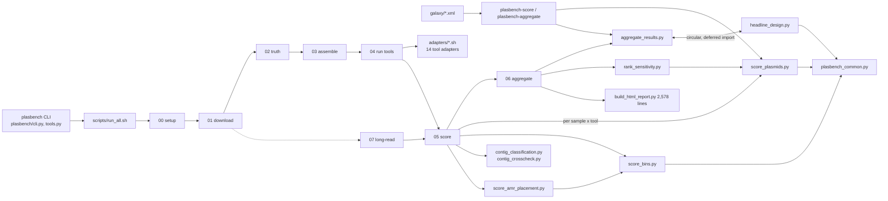

# PlasBench performance and architecture audit

Date: 2026-11-09. Scope: the whole repository (`python/`, `scripts/`, `adapters/`, `plasbench/`, `galaxy/`, `test/`).
Sections A–N are the audit as performed, before any change. The roadmap was then implemented; the next
section records what changed and how each change was validated. The timing harnesses are in `test/bench/`.

## Implementation status

| Roadmap item | Status | Where | Validation |
|---|---|---|---|
| Rectangular bin matching (both copies) | **Done** | `python/matching.py`; `score_bins.maximum_weight`, `metagenomics.hungarian_max` are adapters | `test/test_matching.py`: equal total weight on 1,530 random instances; identical pairs on all 1,373 with a unique optimum; 8 tied instances choose a different, equal-weight pairing (deterministic). End to end, `score_bins.py` on 2,000 one-contig bins: **2,495.8 s on `main` → 0.4 s** (200 bins: 2.1 → 0.3 s). |
| Exact statistics without `Fraction` | **Done** | `python/resampling.py` (exact mean, cluster bootstrap, sign-flip tests, stratified variants) | `test/test_resampling_equivalence.py`: 20,000 means and 16 resampling designs bit-identical to verbatim copies of the earlier code; `test_robustness_diagnostics.py` still passes. `aggregate_results.py`, identical inputs, `main` → branch: 20 × 8 tools on 1 worker 18.5 → 4.3 s (4.3×); 100 × 8 on 1 worker 25.5 → 9.9 s; 100 × 8 on 12 workers 8.5 → 3.8 s; 300 × 8 on 12 workers 11.6 → 7.1 s; 100 × 15 tools on 12 workers 18.4 → 8.1 s. |
| Break the `headline_design` ↔ `aggregate_results` cycle | **Done** | Both import from `resampling.py` and re-export the old names | Existing tests import the old names unchanged |
| Fingerprint stage-4 result reuse | **Done** | `scripts/04_run_tools.sh` (`tool_fingerprint`, `is_complete`, `mark_complete`) | `test/test_tool_result_fingerprint.sh`: reuse on no change; re-run on an upgraded executable (never run to ask its version), a changed `<TOOL>_*` setting or new contigs; thread counts ignored; legacy markers re-run unless `REUSE_UNFINGERPRINTED=1` |
| Capability registry read once | **Done** | `tool_capabilities.py --dump`; `lib.sh load_capabilities` | `test/test_capability_cache.sh`: identical answers to the per-call lookups for all 27 tools, an unknown tool and an invalid registry. It caught a `\r` bug on Windows during development. |
| One minimap2 index per sample | **Done** | `scripts/05_score.sh` (`MM2_TARGET`) | WSL, minimap2 2.26, demo sequences: byte-identical PAF in 105 of 105 call shapes |
| Merge the two minimap2 passes per tool | **Not adopted** | – | The combined pass reproduced the primaries (35 of 35) but changed the ambiguity diagnostic in 6 of 35 (that pass runs without `-c`), so the change would alter a reported result |
| Core scorer defaults vs pre-registration | **Done (entry point)** | `plasbench/tools.py` (`plasbench-score`); a note on direct `score_plasmids.py` runs | `test/test_score_entry_filters.py`. The script defaults stay unfiltered: about 25 tests use the scorers as pure functions |
| Consolidate duplicated readers | **Done** | `plasbench_common.py`: `read_truth_table`, `read_truth_split`, `read_bin_membership`, `iter_fasta`, `open_maybe_gz`, `union_length`; 20 local copies replaced | Full test suite and the demo. `bin_quality.py` now follows the bin scorer's rules (intended). `number()` copies with different semantics, the three-class truth reader and the multi-membership bin readers were left alone on purpose. |
| Parallel stage-6 advisory group | **Done** | `scripts/06_aggregate.sh` (`STAGE6_PARALLEL_JOBS`, default 4) | Bash syntax check; each job keeps its warn-only failure handling; the stage waits before anything downstream reads the tables |
| Leaderboard writer guard | **Done** | `aggregate_results.write_tsv` refuses a column/value count mismatch | Every aggregation test |
| Performance regression harness | **Done** | `test/bench/` (run by hand; not timed in CI) | – |
| Split `build_html_report.py` and the README | **Not done** | – | Editorial work with no runtime effect; still listed as open item 9 in the README |

### End-to-end check: the bundled demo, before and after (WSL Ubuntu, same machine)

| | `main` (before any change) | After the changes |
|---|---:|---:|
| `test/run_demo.sh` wall time | 645.9 s | 179.7 s (3.6× faster) |
| Output files | 528 | 528 |
| Byte-identical outputs | – | 527 of 528 |

The one differing file is `benchmark.report.html`, and only in timestamps (generation time and the file
times it lists) plus one listed size of `benchmark.bin_quality.tsv`, which another process rewrote after the
baseline's report was generated. That data file itself is byte-identical in both runs.

### Data-structure and algorithm techniques applied (second round)

Each change was benchmarked on fixed synthetic inputs before and after (`test/bench/bench_dsa.py`,
`test/bench/bench_downloads.py`), and each prints a hash of its output. Timings below are from back-to-back runs of
the two code versions on the same machine minutes apart (an earlier pair, taken under other load, gave smaller
ratios in the same direction). **Every output hash is identical
before and after**: these changes alter cost, never results.

| Technique | Where | Before → after | Complexity |
|---|---|---:|---|
| Hash map index instead of a scan per bin | `bin_agreement.per_bin_rows` (best match per bin, 3,000 single-contig bins) | 1.215 s → 0.019 s (64×) | O(bins × overlaps) → O(overlaps) |
| Hash set instead of list membership | `bin_agreement.read_bins` (60,000 rows, large bins) | 13.66 s → 0.16 s (86×) | O(k²) per bin → O(k) |
| Linear `min()` instead of sort-then-first | `bin_agreement.per_bin_rows` best match | (included above) | O(c log c) → O(c) |
| Hash sets instead of probing every row × column | `matching.max_weight_matching` live rows/columns (5,000 bins, 30 plasmids) | 0.027 s → 0.004 s (6.8×) | O(rows × cols) → O(edges) |
| Bounded heap (top-k) instead of a full sort | `build_visualization_data.top_blocks` (500 of 200,000 blocks) | 0.54 s → 0.26 s (2.1×); O(k) instead of O(n) extra space | O(n log n) → O(n log k) |
| Sliding window between precomputed N positions (two pointers), bytes encoded once | `contig_crosscheck.sampled_kmers` (1 Mb) | 2.66 s → 1.05 s (2.5×); the blake2b hash per k-mer, which defines the sample, now dominates | same O(n), smaller constant |
| Bit manipulation: bulk 32-bit Mersenne Twister words decoded into flip bits and bootstrap indices, sums via `itertools.compress` | `resampling.py` | **Tried and reverted.** Identical p-values, but 10% slower for the permutation test and 2× slower for the bootstrap: cProfile had inflated the per-call cost of the one-bit draw, and decoding words in Python costs as much as the C-level `getrandbits` calls it replaced. Kept instead: the bit draw inlined (no function call per draw) | – |
| Counting pass (`Counter`) instead of `list.count` per item | `freeze_prereg.read_rows` duplicate check | not measurable (dozens of rows) | O(n²) → O(n) |
| Binary search per record instead of a scan per bin | `score_plasmids.calibration` | 0.171 s → 0.102 s (1.7×) | O(n × bins) → O(n log bins) |
| Streaming with a filter instead of loading whole files | `iter_fasta(path, wanted)`; `database_containment` (truth plasmids out of the reference), `build_visualization_data` (only displayed records) | peak memory 12.7 MiB → 0.4 MiB (5 Mb chromosome + 3 plasmids) | O(genome) → O(largest wanted record) |
| Parallel downloads: both mates at once, plus N byte ranges per large file (HTTP Range; aria2c when installed) | `fetch_ena_reads.py` | 8.6 s → 1.6 s for 2 × 16 MiB at 4 MiB/s per connection (5.4×); 1.2 s with `ENA_DOWNLOAD_CONNECTIONS=8` | wall time ÷ connections while the link is not saturated |

### Pipeline-level techniques (third round)

| Technique | Decision | Evidence |
|---|---|---|
| Thread budget against oversubscription | **Done.** With `THREADS` unset, `config.sh` divides the cores across `MAX_PARALLEL_SAMPLES × MAX_PARALLEL_TOOLS`; the per-tool `*_THREADS` follow | 2 samples × 3 tools on 12 cores: 72 threads requested on `main` (a warning only), 12 now (`test/test_thread_budget.sh`). One slot still gets every core; an explicit `THREADS` wins |
| Shared read-only index instead of rebuilding per call | **Done** (round one): one `minimap2 -d` index per sample | Byte-identical PAF in 105 / 105 call shapes |
| Generators / lazy streaming | **Done.** Every reader already streams (no `readlines()` anywhere); `iter_fasta(wanted=…)` now also skips unwanted records without joining them | Peak 12.7 → 0.4 MiB on a reference read |
| Pre-compiled regular expressions | **Done** where one ran per record (`build_visualization_data` CIGAR parsing); `alignment_accuracy` was already compiled | The other 10 inline patterns run once per file or per label, and Python caches compiled patterns anyway |
| Caching of finished steps | **Done** (round one): fingerprinted stage-4 reuse; downloads, assemblies and the recall ceiling were already reused | `test/test_tool_result_fingerprint.sh` |
| Named pipes (FIFOs) between tools | **Recommended, not shipped.** The one large write-then-read is stage 1: `fasterq-dump` writes uncompressed FASTQ that `pigz` re-reads (0.5–3 GB per mate). The fix is `fasterq-dump` writing into FIFOs that `pigz` drains. `fastp` → SPAdes cannot use pipes (SPAdes reads its inputs several times) | `fasterq-dump`, `fastp`, `pigz` and the assemblers are not installed on the audit machine or its WSL, so the change could not be verified against the tools' real output behaviour, and an unverified change to the read-extraction step would put every downstream result at risk. Stage 5's only temporary file (recall-ceiling windows) is a few MB, too small to matter |
| Workflow engine (Snakemake / Nextflow) | **Not adopted here** | The fingerprinted reuse and bounded job slots cover the caching and core-mapping benefits; a migration is a separate project and the Galaxy wrappers already serve hosted runs |
| Binary columnar formats (Arrow / Parquet, Polars) | **Not adopted** | PlasBench is standard-library only by design, and its tables are small (a 98-isolate × 15-tool run has about 1,500 score rows); parsing is not a measured cost anywhere in the profiles |
| Read subsampling to a coverage cap before assembly | **Not adopted as a default** | It changes the input every tool is benchmarked on, so it would change results. Controlled subsampling already exists as a sensitivity analysis (`make_depth_ladder.py`, `make_read_quality_ladder.py`) |
| Memory-mapped classifier databases (Kraken2 `--memory-mapping`) | **Not applicable** | PlasBench runs no read-level taxonomic classifier; the benchmarked tools load their own databases |

**Considered and not changed.** `interval_overlap_bp` already uses a two-pointer sweep; the PR-curve sweep
is already incremental with binary search; `UnionFind.find` is already iterative with path halving;
`repeat_content` already packs k-mers into 2-bit integers on a rolling window. The only recursion,
`build_html_report`'s file-tree `render`, recurses as deep as the results directory nests (a few levels),
so converting it to an explicit stack would add risk for no measurable gain. `prefetch` / `fasterq-dump` / `datasets download` manage their own transfers; stage 1
already runs samples in parallel (`MAX_PARALLEL_SAMPLES`).

## How to read the numbers

| Label | Meaning |
|---|---|
| **Measured** | Timed on this machine: Windows 11, Python 3.14.3, 12 logical CPUs, repository on a OneDrive-synced drive. |
| **Estimated** | Derived from measured unit costs times counted operations. Not run end to end. |
| **Theoretical** | Read from the code (complexity class). Not timed. |

Two caveats apply to every measured number:

1. PlasBench targets Ubuntu. On this Windows machine a bare `python -c pass` takes **0.65–0.93 s**, and loading a
   scorer script takes about 1.4 s even for `--help`. On Linux, interpreter start-up is normally tens of
   milliseconds. Absolute times for short scripts are therefore pessimistic here, while the *ratios* between
   algorithms are not affected.
2. The external tools (SPAdes, fastp, minimap2, MOB-suite, Platon and the others) are **not installed here**,
   so stages 1, 3 and 4 and the minimap2 calls in stage 5 were not measured. On real runs they almost certainly
   dominate wall time. `tool_status.tsv` already records `runtime_seconds` and `peak_rss_kb` for every tool run.
   That is the right source for those numbers once a real cohort run exists.

---

## A. Executive assessment

PlasBench is a **pipeline of standalone, standard-library-only Python scripts driven by numbered bash
stages**, exchanging TSV files. There is no database, no service layer and no third-party Python dependency.
For a benchmark of about 100 isolates this is an appropriate architecture: easy to audit, reproducible and
portable. **No rewrite is recommended.**

There is visible earlier optimisation work: an exact mean that avoids `statistics.mean`, a cheaper sign-flip
random stream, an incremental O(E log E) precision-recall sweep, a process pool for paired statistics, and
parallel sample and tool slots. Most hot paths are already linear or near-linear.

The measured problems are concentrated in a few places:

| # | Finding | Evidence | Impact |
|---|---|---|---|
| 1 | **Dense Hungarian matching** in `score_bins.maximum_weight` pads to a max(B, P) square: O(max(B,P)³) time | 200 bins × 20 plasmids: **2.07 s**, against **0.004 s** for a rectangular solver (498×), same total weight | Seconds to hours per sample once a tool emits hundreds of bins (the trivial baselines emit one bin per contig). The same algorithm is duplicated in `metagenomics.hungarian_max`. |
| 2 | **Aggregation is dominated by exact `Fraction` arithmetic** inside the stratified permutation test | 20 samples × 8 tools: **80 s** serial. Profile: 87% in `stratified_permutation`, 78% in `exact_mean` (1.27 M calls) | Stage 6 cost grows with tools² × 10,000 permutations × samples. Two bit-identical prototypes give 2.5× and 2.8×. |
| 3 | **Per-call process overhead.** The demo makes 300 Python launches in 481 s; a static registry lookup is launched up to 5 times per (sample, tool) | `tool_capabilities.py`: 44 launches = **60.1 s (12.5%)** of the demo | About 7,000 avoidable launches on a 98 × 15 run (estimated) |
| 4 | **Stale-result risk.** Stage 4 reuses a tool result whenever a `.complete` marker exists, whatever the tool version, database release, parameters or input contigs | `scripts/04_run_tools.sh:138` `is_complete()` | Reproducibility, not speed: an upgraded tool can silently reuse old predictions. |
| 5 | **Duplicated scientific helpers**, some with diverging behaviour | `read_truth` ×11, `read_fasta` ×6, Hungarian ×2, interval merge ×5 | Maintenance risk. One divergence is latent today (see E). |

---

## B. Architecture and dependency map

* 113 Python modules (25,658 lines), 15 stage scripts (3,951 lines), 14 adapters, 198 test scripts (20,475 lines).
* Only 45 of the 113 modules import a shared helper. The rest are self-contained, which is why helpers are
  re-implemented (section E).
* The hubs are `plasbench_common.py`, `headline_design.py` and `validate_cohort.py`. Scripts are also imported
  as libraries: `rank_sensitivity → score_plasmids`, `score_amr_placement → score_bins`,
  `validate_recommendations → aggregate_results`.
* **Circular dependency:** `aggregate_results.py:34` imports `headline_design`, and `headline_design.py:218, 243, 302`
  import `bootstrap_ci`, `paired_permutation_pvalue` and `resampling_units` back from `aggregate_results` inside
  functions. It works, but the resampling primitives have no single home.
* **Silos:** the isolate track (`score_bins.py`) and the metagenomic track (`metagenomics.py`) each carry their
  own Hungarian solver and their own bin readers.
* **Database:** none. Section H is not applicable.

---

## C. Runtime analysis

### C1. End-to-end demo (`test/run_demo.sh`, mock tool outputs, every Python stage) — measured

Six demo isolates, mock tools, precomputed alignments, traced with `bash -x` timestamps.

**Total: 481 s wall, 300 Python process launches, about 1,080 shell commands.** Every launch averages 1.6 s.
A bare script start (`--help`) costs about 1.4 s here, so roughly 300 × 1.4 s ≈ 7 of the 8 minutes is
probably interpreter start-up and imports rather than computation (estimated from that floor).

| Script | Wall time | Share | Launches | Note |
|---|---:|---:|---:|---|
| `contig_crosscheck.py` | 61.1 s | 12.7% | 7 | Alignment-free k-mer labels, about 9 s per sample: real work |
| `tool_capabilities.py` | 60.1 s | 12.5% | 44 | **Static registry lookup**, about 1.4 s per launch: pure overhead |
| `score_plasmids.py` | 49.4 s | 10.3% | 29 | About 1.7 s per call, close to the start-up floor |
| `contig_classification.py` | 49.3 s | 10.3% | 36 | Mostly start-up |
| `bin_agreement.py` | 37.2 s | 7.7% | 26 | |
| `score_amr_placement.py` | 33.6 s | 7.0% | 21 | |
| `alignment_accuracy.py` | 26.9 s | 5.6% | 29 | |
| `score_bins.py` | 22.9 s | 4.8% | 12 | Few bins in the demo, so the matcher is not stressed |
| `feature_preservation.py` | 21.6 s | 4.5% | 25 | |
| Shell commands (non-Python) | 18.2 s | 3.8% | 1,079 | |
| `build_html_report.py` | 7.6 s | 1.6% | 1 | |

On this workload, wall time is set by **how many processes are started, not by algorithms**. With six demo
isolates, `aggregate_results.py` does not reach the cost shown in C2.

### C2. Component timings — measured

| Workflow | Stage / component | Input | Wall time | Memory | Bottleneck |
|---|---|---|---:|---:|---|
| Scoring | `score_plasmids.py` (one sample × tool) | 200 / 2,000 / 20,000 alignments | 2.85 / 2.82 / 2.17 s | not measured | Flat across a 100× input range, so this is fixed start-up cost, not the algorithm |
| Scoring | `score_bins.py`, one bin per contig | 200 bins, 6 plasmids | **15.6 s** | not measured | Dense Hungarian, called twice per run |
| Scoring | `maximum_weight` alone | 50 / 100 / 200 / 300 bins | 0.021 / 0.229 / 2.07 / 7.32 s | 0.5 MB traced at 200 | O(n³) on a padded square |
| Aggregation | `aggregate_results.py`, 8 tools, 1 worker | 20 / 100 / 300 samples | 80 / 148 / 224 s | not measured | Stratified permutation test |
| Aggregation | same, 12 workers | 100 / 300 samples | 47.5 / 49.9 s | not measured | Process pool helps 3–4.5× |
| Aggregation | 15 tools (105 pairs), 12 workers | 100 samples | 87.9 s | not measured | Pairs grow with tools² |
| Truth diagnostics | `repeat_content.canonical_kmers` + `Counter`, k = 29 | 1 Mb / 5 Mb random genome | 2.1 s (untraced) / about 10 s (estimated) | 86 / 346 MB traced peak | Pure-Python k-mer table; once per sample |
| Start-up | `python -c pass` | – | 0.65–0.93 s | – | Machine-specific (see caveat 1) |

### C3. Profile of aggregation (20 samples × 8 tools, 1 worker, cProfile) — measured

| Function | Cumulative share | Calls |
|---|---:|---:|
| `headline_design.stratified_permutation` | 87% | 28 (one per tool pair) |
| `headline_design.exact_mean` | 78% | 1,272,256 |
| `headline_design.macro_mean` | 76% | 280,064 |
| `fractions.Fraction.__new__` / add / div | about 55% combined | 4.3 M |
| `headline_design.stratified_bootstrap` | 12% | 36 |

The stratified path is taken whenever at least one species reaches `MIN_SPECIES_CLUSTERS`. On `public-v3`,
22 *E. coli* clusters qualify, so it applies to the real headline.

---

## D. Algorithmic complexity

Notation: B = predicted bins, P = truth plasmids, E = alignments, T = tools, n = samples, u = independent
clusters, I = 10,000 permutations, R = 1,000 bootstrap draws, L = genome length.

| Method (file) | Current complexity | Space | Basis | Concern | Recommended |
|---|---|---|---|---|---|
| `score_bins.maximum_weight` (`python/score_bins.py:297`) | O(max(B,P)³) | O(max(B,P)²) dense cost matrix | Code + measured | Cubic in the larger side; most cells are zero | Rectangular Hungarian, O(min² · max) time and O(B·P) space; 498× measured at 200 × 20 |
| `metagenomics.hungarian_max` (`python/metagenomics.py:226`) | O(max(B,P)³) | O(max(B,P)²) | Code (theoretical) | Same as above, on communities with more bins | Share one rectangular solver |
| `headline_design.stratified_permutation` (`:241`) | O(I · n) per pair, O(T² · I · n) per track | O(n) | Code + profile | Large constant: rebuilds lists and exact Fractions every iteration | Precompute exact integer sums per cluster: O(I · u) integer adds per pair; 2.8× measured, identical p-values |
| `headline_design.exact_mean` (`:175`) | O(k) fsum passes + Fraction | O(k) | Code + profile | `Fraction` object overhead | Integer numerator over a power-of-two denominator, one int/int division: 2.5× measured, bit-identical |
| `headline_design.stratified_bootstrap` (`:212`) | O(R · n) per call | O(R) | Code | 12% of aggregation | Same integer trick |
| `aggregate_results.paired_permutation_pvalue` (`:687`) | O(I · n) | O(n) | Code | Already uses `fast_mean` | Keep |
| `score_plasmids.sweep_thresholds` (`:428`) | O(E log E) | O(E) | Code (already incremental) | None | Keep |
| `score_plasmids.parse_paf_intervals` / `merge_intervals` | O(E log E) | O(E) | Code | None; streams the PAF | Keep |
| `repeat_content.canonical_kmers` + `Counter` | O(L) time | O(L) distinct k-mers | Code + measured | Python-object memory: about 70 B per k-mer | Acceptable for ≤ 12 Mb references; revisit only for metagenomes |
| `bin_agreement` overlaps and dissimilarity | O(T² · contigs) per sample | O(contigs) | Code | Hash-based, linear per pair | Keep |
| `rank_sensitivity` / `composite_score` reweighting | O(draws · T) | O(T) | Code | 500 draws, small T | Keep |

**Pairwise explosion check.** The only quadratic growth is tool pairs in stage 6. It is bounded by about 15
tools per track (105 pairs) and already parallelised. Nothing in PlasBench builds an all-against-all plasmid
distance matrix: it benchmarks tools and does not cluster plasmids. Mash and MinHash are only used for cohort
de-duplication.

---

## E. Duplicate implementations

| Implementation 1 | Implementation 2+ | Type | Overlap | Risk | Recommendation |
|---|---|---|---|---|---|
| `score_bins.maximum_weight` | `metagenomics.hungarian_max` | C (algorithmic) | Same dense Hungarian, different input shapes (edge dict vs matrix) | A fix to one misses the other | One rectangular solver in `plasbench_common`, with thin adapters |
| `score_plasmids.read_truth` (validates types, lengths, duplicates) | `score_bins`, `bin_quality`, `contig_classification`, `audit_three_class_scoring`, `compute_difficulty_features`, `derive_amr_truth`, `label_truth_evidence`, `repeat_content`, `truth_depth_anomalies` `.read_truth` | D (scientific logic) | 11 readers of the same `truth.tsv` | `bin_quality.read_truth` files every non-`PLASMID` row as chromosome. `compute_difficulty_features` does not upper-case. **Latent only**, because the scorer already refuses any other label. `scorable_truth.py` was already fixed the same way (its docstring says so). | Make each one delegate to the validating reader, as `scorable_truth` does |
| `plasbench_common.merge_intervals` | `score_bins.merge`, `contig_classification.merge`, `score_plasmids.merge_intervals`, `select_operational_method.merge_intervals` | B / C | Interval union length | Low: same result, different tuple shape | Keep one in `plasbench_common`. `score_bins` already imports it and still defines its own `merge()`. |
| `baseline_predictors.read_fasta` | `build_visualization_data`, `database_containment`, `detect_dimers`, `repeat_content`, `scorable_truth` `.read_fasta`; plus 3× `read_fasta_lengths`, 4× `fasta_ids`, 3× `open_maybe_gz` | G (data processing) | FASTA parsing | Header handling differs (`split()[0]` vs whole header) | One streaming reader with an option to keep the header |
| `score_bins.read_bins` | `bin_agreement`, `bin_quality`, `copy_number` `.read_bins` | B | Bin table | Validation differs (only `score_bins` rejects duplicates) | Shared reader with the strict validation |
| `plasbench_common.sha256` | `design_synthetic_communities`, `freeze_prereg`, `write_manifest` | A | Same | Low | Import the shared one |
| `plasbench_common.number` | 9 other `number()` helpers | A / B | Number parsing | Low | Import the shared one |
| Alignment thresholds in `config/prereg.tsv` and `config.sh` (0.90 / 20 / 0.20) | argparse defaults 0.0 / 0 / 0.0 in `score_plasmids`, `score_bins`, `score_amr_placement`, `scorable_truth`; 0.90 / 20 / 0.20 in `alignment_accuracy`, `bin_quality`, `feature_preservation`, `rank_sensitivity` | F (configuration) | Same parameter, two defaults | The pipeline and the Galaxy wrapper pass values explicitly, so results are consistent today. A bare manual `plasbench-score` call silently uses no filter. | Default the core scorers from the same environment variables, or make the flags required |

---

## F. Architectural silos

* **Appropriate modularity.** Each script does one job and is testable on its own (198 test scripts). This
  is a strength, not a silo.
* **Unnecessary isolation.** About 68 modules re-implement small readers instead of importing
  `plasbench_common`. This is the source of the type D risk above.
* **Shell-to-Python boundary used for lookups.** Bash calls Python for static registry facts
  (`05_score.sh:43-54`, `lib.sh:257`): a process per question.
* **Two bin-scoring stacks** (isolate and metagenomic) share no code.
* **Recommended shape:** keep the modular-monolith pipeline. Grow `plasbench_common` into the single home
  for readers, interval and matching primitives, and move the resampling primitives into `headline_design`
  (or a small `stats` module) to break the cycle. A workflow engine (Snakemake or Nextflow) would add value
  for cluster scheduling and caching, but it is a separate decision, and the Galaxy wrappers already cover
  hosted use. Microservices are not appropriate.

---

## G. Memory and resources

* Isolate-scale data are small: about 5 Mb references, thousands of contigs. Every scorer streams its PAF.
  No memory risk was found for the isolate track.
* Measured peaks: the dense Hungarian matrix is 0.5 MB at 200 × 20 but grows with max(B,P)². At 5,000 bins
  it would hold 25 M Python ints (about 0.7 GB; estimated). The k-mer `Counter` for a 5 Mb genome peaks at
  about 346 MB traced.
* FASTA readers load whole files into memory, which is fine for isolate references. A metagenome-scale
  reference (`--max-chromosome-bp` is 12 Mb) is the upper bound in use.
* File handles are opened with `with` throughout. No leak pattern was found.

## H. Database

Not applicable: the project has no database, ORM or connection management. Data access is file-based TSV.

## I. Bioinformatics-specific

| Area | Current | Finding |
|---|---|---|
| FASTA / FASTQ ingestion | Streaming line readers; FASTQ handled by fastp and the tools | Fine; duplicated readers (E) |
| Sequence comparison | minimap2 per (sample, tool) with the FASTA reference | The reference index is rebuilt on every call: up to 4 calls per tool per sample (`05_score.sh:121, 185, 239, 243, 283`), and no `.mmi` is ever written. Unmeasured here. Building one index per sample with the same preset should give identical alignments, which must be verified. |
| Two alignment passes per tool | `--secondary=no`, then `--secondary=yes -N 20` for ambiguity | A single pass with primaries filtered by `tp:A:P` could replace both. Adopt only after showing identical primary PAFs. |
| Plasmid / chromosome discrimination | Base-level projection; contig labels with a k-mer cross-check | Linear |
| Clustering | Not performed (by design) | N/A |
| AMR | `score_amr_placement` reuses the bin matcher | Inherits finding 1 |
| Structural analysis | `call_structural_variants`, NGOC | Linear per alignment set |

**Scientific restriction.** Every change proposed below either keeps results bit-identical (findings 2 and 3)
or keeps the optimum identical with a defined tie-break (finding 1). None removes a coverage, identity or
MAPQ requirement.

## J. Parallelisation and caching

* **Present:** `MAX_PARALLEL_SAMPLES` (stages 1, 3, 4, 5) and `MAX_PARALLEL_TOOLS` (stage 4) with `job_slot_wait`,
  per-tool `*_THREADS`, an oversubscription warning, and a process pool for tool-pair statistics above 2,000
  paired samples. The measured pool gain is 3–4.5× on 12 CPUs.
* **Defaults are serial** (`MAX_PARALLEL_SAMPLES=1`, `MAX_PARALLEL_TOOLS=1`). That is reasonable for memory-heavy
  assemblers, but scoring is light and could default higher for stage 5 only.
* **Stage 6 is serial across its 35 Python calls.** Most are independent diagnostics after `aggregate_results`,
  and could run as a bounded parallel group.
* **Caching:** download, assembly and tool outputs are reused, and the recall-ceiling windows carry a parameter
  fingerprint (`05_score.sh:178-194`). The **tool-output cache has no fingerprint** (finding 4). Fingerprint it
  with tool version, database release, parameters and the input-contig SHA-256, following the existing
  `SCORABLE_PARAMS` pattern.

## K. Scalability

| Dimension | Growth | Measured | Practical limit (estimated) |
|---|---|---|---|
| Samples, stages 1–5 | Linear; parallel slots | External tools not measured | Tool runtime and memory |
| Bins per sample (`score_bins`) | Cubic in max(B,P) | 0.02 s at 50 → 7.3 s at 300 | Minutes at 500 bins; hours at 2,000 (about 8 × 10⁹ inner steps) |
| Tools per track (stage 6) | Quadratic in T (pairs) × I × n | 28 pairs → 105 pairs: 47.5 → 87.9 s at 100 samples, 12 workers | Fine for ≤ 15 tools |
| Samples, stage 6 | Close to linear in clusters, with a large constant | 20 → 300 samples: 80 → 224 s serial | Fine for the planned ≤ 100–300 isolates |
| 10,000–100,000 plasmids | Not applicable to the isolate benchmark | Not tested | The metagenomic track is the only place large B and P occur; finding 1 is the blocker there |

## L. Technical debt

* `build_html_report.py` is 2,578 lines and `aggregate_results.py` is 1,431 lines. `write_tsv` in
  `aggregate_results` writes about 90 columns positionally, so each new column must be added in two aligned places.
* `README.md` is 3,379 lines (already listed as open item 9 in the README).
* A circular import is masked by in-function imports (B).
* Thresholds are defined in three places (`prereg.tsv`, `config.sh`, argparse defaults) and can drift (E).
* There are no performance-regression tests. Equivalence tests exist for the statistics
  (`test_robustness_diagnostics.py` re-derives results with `statistics.mean`) and for the incremental PR
  sweep, which is the safety net for findings 1–2.

## M. Optimisation roadmap

| Priority | Problem | Current | Proposed change | Expected benefit | Risk | Validation |
|---|---|---|---|---|---|---|
| **High** | Cubic dense matching (`score_bins.maximum_weight`, `metagenomics.hungarian_max`) | Square n = max(B,P) Hungarian | One rectangular solver (rows = smaller side), dropping zero-edge rows, in `plasbench_common` | **Measured** 44–498× on the matcher at 50–300 bins; removes the hours-scale case | Equal-weight optimal matchings could pick a different pair, changing which bin is "matched" | Property test against the current solver on random instances: identical total weight always, identical pairs where the optimum is unique; a deterministic tie-break; all demo and test outputs byte-identical |
| **High** | Exact mean via `Fraction` (78% of stage 6) | `sum(map(Fraction, terms)) / n` | Integer numerator over a power-of-two denominator; precomputed per-cluster exact sums in the permutation and bootstrap loops | **Measured** 2.5× (mean) and 2.8× (permutation); 0 / 200,000 and 12 / 12 identical | Very low: same single correctly rounded division | `test_robustness_diagnostics.py`, `test_research_design.py`, a new old-vs-new equivalence test, and before/after timings at 20 / 100 / 300 samples |
| **High** (reproducibility) | Tool-output reuse ignores versions and parameters | `.complete` marker | Write a fingerprint (tool version, database release, parameters, input SHA-256) beside the marker; mismatch → re-run | Prevents silently stale results | Forces re-runs after upgrades (intended) | Stage-4 shell tests: version change → re-run; same inputs → reused |
| Medium | Python launched per registry lookup | Up to 5 launches per (sample, tool) | Read `tool_capabilities.tsv` once per stage into a bash associative array (or one Python call that prints the table) | **Measured** 12.5% of the demo; about 7,000 launches saved on 98 × 15 (estimated) | Low | Identical `scores.tsv` on the demo; `test_script_wiring.py` |
| Medium | Reference index rebuilt per minimap2 call | FASTA reference each time | One `minimap2 -x $PRESET -d ref.mmi` per sample | Unmeasured; scales with tools × calls | Index must match the preset | Byte-identical PAFs on a real sample |
| Medium | Diverging duplicate readers | 11 `read_truth`, 6 `read_fasta`, 4 `read_bins` | Delegate to validated shared readers, one module at a time | Removes type D drift | Low with output-equality tests | Each module's existing test plus a golden output |
| Medium | Core scorer defaults differ from the pre-registration | 0.0 / 0 / 0.0 defaults | Default from `MIN_ALIGNMENT_*` like the diagnostics, or require the flags | Prevents unfiltered manual runs | Changes the result of bare manual calls (intended) | Galaxy test data, `test_scoring.py` |
| Low | Serial stage 6 diagnostics | 35 sequential calls | Bounded parallel group after `aggregate_results` | Wall-time reduction proportional to cores (estimated) | Ordering of warnings in logs | Identical `benchmark.*.tsv` set |
| Low | Circular import | In-function imports | Move resampling helpers into `headline_design` or `stats.py` | Clarity | None | Existing tests |
| Low | No performance regression guard | – | Commit the scratch harnesses as `test/bench/` with generous time ceilings | Catches regressions | Flaky if ceilings are tight | Run in CI on Linux |
| Not recommended | Rewrite with a database, microservices or numpy | – | – | – | Adds dependencies to a deliberately stdlib-only, auditable tool | – |

## N. Scorecard (0–10)

| Area | Score | Evidence |
|---|---:|---|
| Algorithmic efficiency | 7 | Most paths linear or O(n log n), with an incremental PR sweep; one cubic matcher in two places |
| Runtime efficiency | 6 | Stage 6 is dominated by `Fraction` overhead; heavy fixed start-up cost per script |
| Memory efficiency | 8 | Streams alignments; only the dense matrix and k-mer `Counter` grow notably |
| Database efficiency | N/A | No database |
| Sequence-processing efficiency | 7 | Delegated to minimap2 and the tools; index not reused (unmeasured) |
| Clustering efficiency | N/A | No plasmid clustering by design |
| Parallelisation | 7 | Sample and tool slots plus a statistics process pool; serial defaults; stage 6 serial |
| Caching | 5 | Broad reuse, but the tool cache is unfingerprinted |
| Code reuse | 4 | 11 truth readers, 6 FASTA readers, 2 Hungarian solvers; only 45 of 113 modules use the shared module |
| Architectural cohesion | 7 | Clear stages and TSV contracts; one circular import; two bin-scoring stacks |
| Modularity | 8 | Single-purpose scripts, independently testable |
| Maintainability | 6 | Very large report and aggregate modules; positional 90-column writer; 3,379-line README |
| Scalability | 6 | Fine for about 100–300 isolates; the matcher blocks bin-heavy and metagenomic inputs |
| Test coverage | 8 | 198 test scripts including statistics equivalence tests; no performance tests |
| Reproducibility | 7 | Pinned seeds, pre-registration, manifests; stale tool-cache risk |

## Reproducing the measurements

The harnesses are outside the repository, in this session's scratchpad: `bench_matching2.py`,
`bench_aggregate.py`, `bench_score.py`, `bench_kmers.py`, `proto_exact_mean.py`, `proto_permutation.py` and
`parse_trace.py`. Each takes the project's `python/` directory as its first argument and changes nothing in
the project. If the roadmap is approved, they become the before/after benchmarks.
